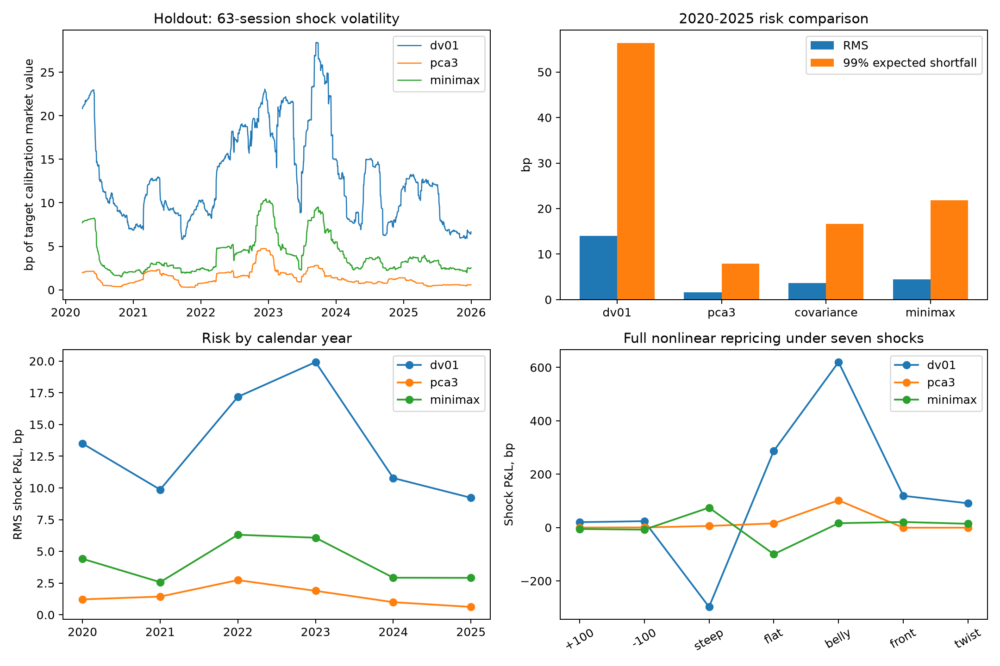

# Treasury curve risk: PCA and regime-robust hedging

How much yield-curve risk remains after matching duration, and does a hedge designed for the worst historical regime improve the result?

This study prices a 15-year annual-coupon bond and compares four hedges using five hypothetical zero-coupon instruments. It fits all hedge weights on data ending in 2019 and replays a separate 2020-2025 set of curve shocks. The main result is a useful counterexample: the tested minimax hedge improves on a simple duration hedge, but the PCA hedge has lower residual risk on the reserved period.



## Data and fixed split

The source is the Federal Reserve's [daily nominal yield-curve estimates](https://www.federalreserve.gov/data/nominal-yield-curve.htm), using 30 continuously compounded zero-coupon yields at annual maturities. These are fitted off-the-run curves, not executable security quotes; the Fed notes that vintages can be revised.

- 8,985 complete curves from 1990-01-02 to 2025-12-31, with 408 rows excluded for missing yields.
- 7,484 training shocks ending on 2019-12-31; 1,500 holdout shocks dated 2020-2025.
- Calibration prices and all hedge faces are fixed on 2019-12-31.
- Three training regimes: 1990-2006, 2007-2012 and 2013-2019.
- Target book: $1 million calibration market value, 15-year maturity and 4% annual coupon.
- Hedge instruments: 2-, 5-, 10-, 20- and 30-year zero-coupon claims.
- Common gross hedge market-value limit: 1.5 times target calibration market value.

No holdout observations enter the covariance estimates, factor loadings, sensitivities or hedge-weight fit. Missing rows are dropped without interpolation. Each shock joins consecutive complete published curves, so holidays can create gaps in calendar time.

## Holdout results

All figures below are basis points of the target's calibration market value. One bp is $100 for the $1 million target.

| Hedge | RMS shock P&L | 99% expected shortfall | Worst loss |
| --- | ---: | ---: | ---: |
| unhedged | 63.539 | 210.911 | 492.666 |
| dv01 | 13.982 | 56.364 | 75.484 |
| pca3 | 1.631 | 7.897 | 12.720 |
| covariance | 3.622 | 16.663 | 29.504 |
| minimax | 4.469 | 21.868 | 35.004 |

PCA reduces RMS shock P&L by **88.34%** versus the DV01 hedge. A paired circular block bootstrap, using 2,000 resamples of 10 observed sessions, gives a pointwise 95% interval of **[86.12%, 90.17%]**. Expected shortfall uses the worst 15 losses, the top 1% of 1,500 observations.

The minimax hedge reduces RMS risk by **68.03%** versus DV01, but its RMS is **2.74 times** PCA's. Robustness to three fitted training covariance matrices is therefore not a guarantee of better holdout hedge performance. PCA retains the top three empirical covariance factors; the covariance and minimax objectives use fixed 5% diagonal shrinkage. The comparison does not isolate shrinkage from regime selection, so it cannot identify a single causal explanation for the difference.

## Hedge formulations

The target's discounted cash flows provide a 30-dimensional key-rate sensitivity vector. Instrument sensitivities map five market-value weights into the same space. Every hedge matches parallel DV01 at calibration and respects the common gross cap.

1. **DV01:** offset the target's parallel sensitivity with a 10-year zero-coupon claim.
2. **PCA3:** minimize exposure to the top three training covariance factors.
3. **Covariance:** minimize variance under a globally fitted covariance matrix.
4. **Minimax:** minimize the largest variance over the three historical regime matrices.

Positive and negative parts of hedge weights implement the L1 leverage constraint. An epigraph variable handles the minimax quadratic objective. Analytic gradients and SLSQP solve the convex formulations; constraint residuals and optimizer convergence are recorded in `results/metrics.json`.

## What is measured

The experiment measures **constant-maturity yield-shock repricing** with fixed calibrated face positions. Every day it reprices the same hypothetical cash-flow maturity schedule at consecutive observed curves. It is not an investable buy-and-hold or trading-return backtest: actual cash flows age, and carry, roll-down, financing, bid-ask spreads and transaction costs are excluded. The calibration gross limit is not a daily margin limit.

Seven predefined curve shocks cover parallel moves, steepening, flattening, a belly shock, a front-end hike and a bear twist. Full nonlinear repricing is reported alongside the first-order approximation. A parallel-DV01-neutral book can still have a nonzero P&L under a large parallel move because convexity remains.

The bootstrap intervals are descriptive, pointwise comparisons with a fixed baseline. They do not address model selection, data-vintage revision or execution costs. Code and frozen results are provided for inspection.

## Reproduce

```bash
python -m venv .venv
# Windows: .venv\Scripts\activate
# Linux/macOS: source .venv/bin/activate
python -m pip install -e .
python -m curve_risk.experiment
python -m unittest discover -s tests -v
```

The committed snapshot is sufficient for an offline rerun after installing dependencies. Its SHA-256 and package versions are in `results/metrics.json`. Tests verify zero-curve cash-flow prices, price sensitivities against independent finite differences, neutrality and leverage, the minimax bound against a feasible hedge, and the exact expected-shortfall tail count.

## Files

- `data/gsw_nominal_vintage.csv`: immutable source snapshot.
- `src/curve_risk/experiment.py`: loading, pricing, optimization and evaluation.
- `results/holdout_pnl.csv`: per-date, per-strategy shock P&L.
- `results/hedge_weights.csv`: calibrated weights and face positions.
- `results/stress.csv`: exact and linear stress repricing.
- `results/metrics.json`: protocol, diagnostics, metrics and CSV hashes.

Code: MIT license. The Federal Reserve dataset retains its source notice; the code license does not change the dataset's status.
